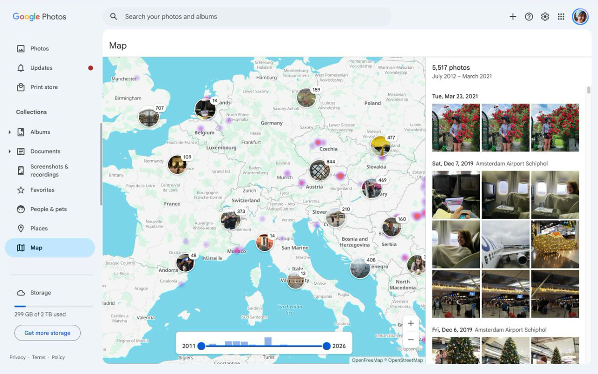

# Map for Google Photos

Google Photos has a map on your phone but not on the web. This Chrome extension adds one: a **Map** item in Google Photos' left menu, next to Places. [taylor.fyi/map-for-google-photos](https://taylor.fyi/map-for-google-photos/)

- A heat map of where you've taken photos, from the whole world down to the street.
- Photo bubbles: click one to zoom into a place or open the photo.
- The photos in view, grouped by day, beside the map.
- A year bar to show only some years.
- Photos open in Google Photos' own viewer and close back into the map, where you left it.
- Follows Google Photos' light and dark themes. The map's position and years live in the address bar, so a place can be bookmarked.

## Privacy

Your photos' locations are read from your own signed-in Google Photos page and kept in the extension's storage on your computer. There's no server, no account and no analytics. Map tiles come from [OpenFreeMap](https://openfreemap.org), so their servers see which map areas you view. Details in [PRIVACY.md](PRIVACY.md).

## Install from source

1. `npm install && npm run build`
2. In Chrome, open `chrome://extensions`, turn on Developer mode, click **Load unpacked**, and pick the `dist` folder.
3. Open [photos.google.com](https://photos.google.com) and click **Map**.

The first visit reads your library once (about 4 minutes for 100,000 photos) and fills the map as it goes. After that it opens at once, adds new photos quietly, and does a full pass weekly to drop deleted ones.

## Develop

- `npm run dev` rebuilds on change, with sourcemaps and these hooks, dispatched from a Google Photos tab's console:
  - `window.dispatchEvent(new Event('photos-map:reload'))` reloads the extension (then reload the tab).
  - `photos-map:light` and `photos-map:dark` preview a theme; `photos-map:wipe` forgets the cache to replay a first visit.
  - `photos-map:slow` and `photos-map:fast` play the photo open and close animations at 1/12 speed and back.
  - `<html data-pm-log>` keeps a short trail of what the content script did.
- `npm run check` runs the type check and tests. `npm run zip` builds the release and packs it for the Chrome Web Store.

## How it fits together

- `src/content/index.ts`: the content script. Adds the nav item, keeps the URL (`#map/@lat,lng,zoomz/2013-2019`) in step with the map, and opens photos in Google's viewer.
- `src/content/library.ts`, `google.ts`, `parse.ts`, `store.ts`: reads photo locations from Google Photos (the same read-only call its timeline uses) and caches them locally.
- `src/content/view.ts`, `grid.ts`, `years.ts`, `flight.ts`: the Map page, drawn over Google's content card in a shadow root, the photo panel, the year bar, and the photo's flight between its tile and Google's viewer.
- `src/engine`: MapLibre and the map style, loaded the first time the map opens.

## License

MIT
